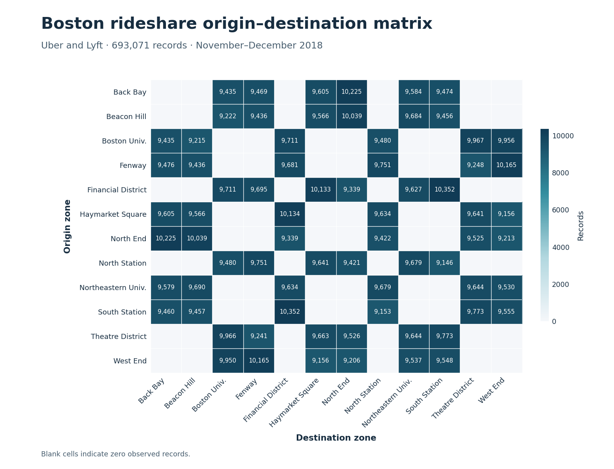

# Boston Rideshare Transportation Planning

**Fare modeling, trip distribution, and revenue optimization for Uber and Lyft observations in Boston.**

[English phase reports](#two-project-phases) · [Results](results) · [Run the notebooks](#run-the-notebooks) · [Persian course reports](reports/original)

This undergraduate Transportation Planning group project analyzes 693,071 Uber and Lyft records across 12 Boston zones in late 2018. The first phase explores fares and weather. The second builds origin–destination matrices, compares five trip-distribution models, and solves a daily market-entry revenue exercise.



## Two project phases

| Phase | Methods and deliverables | Notebook |
| --- | --- | --- |
| 1 — Fare and weather modeling | Exploratory analysis, ANOVA and Tukey comparisons, weather PCA and clustering, rain classification, and fare regression with OLS, boosting, and stacking. [English report](reports/en/phase-1-fare-and-weather-modeling.md) | [Phase 1](notebooks/phase-1-fare-and-weather-modeling.ipynb) |
| 2 — Trip distribution and revenue | Observed and weekday origin–destination matrices, Furness, Detroit, Fratar, two gravity specifications, and a daily linear program. [English report](reports/en/phase-2-trip-distribution-and-revenue.md) | [Phase 2](notebooks/phase-2-trip-distribution-and-revenue.ipynb) |

## Selected results

- The Phase 1 course notebook reported 93.82% accuracy for logistic regression and 95.75% for a decision tree on the rain-classification holdout. The stacking fare model recorded a holdout R² of 0.9478 for log fares.
- The Phase 2 rerun reproduced the trip-distribution convergence counts. Furness, Detroit, and Fratar reached their stopping rules in one iteration. Power and exponential gravity took two and three iterations, respectively. [Convergence table](results/trip-distribution-convergence.csv)
- CBC returned an optimal revenue solution for each of the 12 modeled weekday dates. The model allocates continuous service volumes across four six-hour slots and applies a daily budget of 20 in the dataset's native distance units. [Daily results](results/daily-revenue.csv)

## Run the notebooks

Use Python 3.12. Download the Kaggle CSV as described in the [data guide](data/README.md) and save it to `data/rideshare_kaggle.csv`. The Phase 2 solver is CBC, called through PuLP.

```bash
git clone https://github.com/SalvaDnsh/boston-rideshare-transportation-planning.git
cd boston-rideshare-transportation-planning
python -m venv .venv
# Activate the environment for your operating system.
# macOS/Linux: source .venv/bin/activate
# Windows PowerShell: .venv\Scripts\Activate.ps1
python -m pip install -r requirements.txt
python -m jupyterlab
```

Open a notebook and run the cells in order. Phase 1 includes full-data fitting and cross-validation. The last Phase 2 cell writes the analysis tables to `output/`. See the [reproducibility notes](docs/reproducibility.md) for validation and interpretation details.

## Repository guide

| Location | Contents |
| --- | --- |
| [`notebooks/`](notebooks) | Python implementation for both phases |
| [`reports/en/`](reports/en) | Main English reports |
| [`reports/original/`](reports/original) | Supplementary Persian course reports |
| [`data/`](data) | Dataset source and input instructions |
| [`results/`](results) | Phase 2 tables and the origin–destination figure |

## Academic context

Developed collaboratively for an undergraduate Transportation Planning course at Sharif University of Technology in the 1404 academic year (2025–2026). The submitted reports credit ندا عابدینی، سلوی دانشور، and آرمیتا نصیری‌فر.
